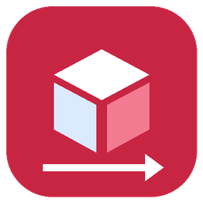
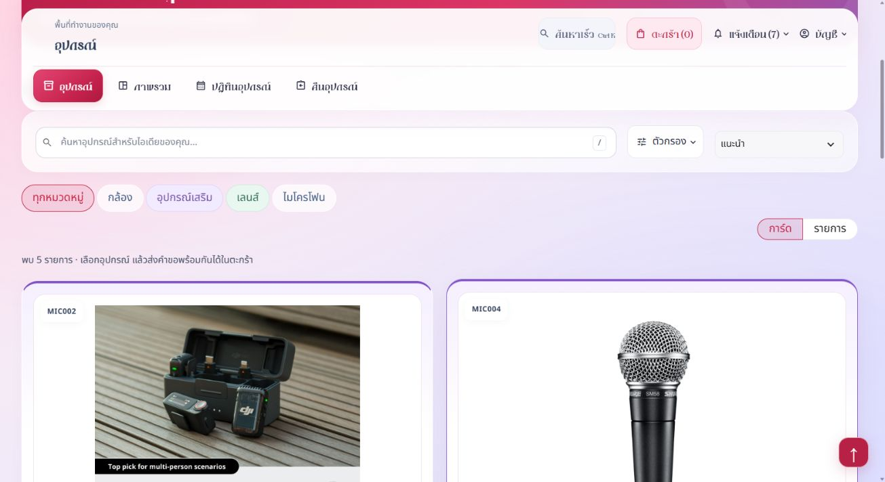
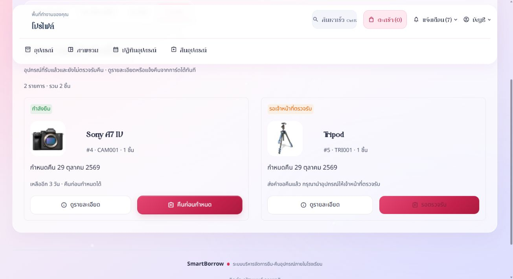
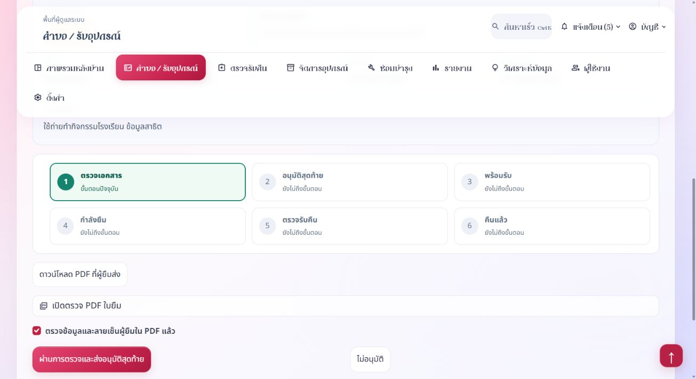
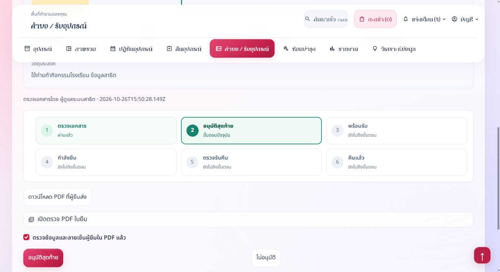

<div align="center">
  
  <h1>SmartBorrow</h1>
  <p>ระบบยืมคืนอุปกรณ์ภายในโรงเรียน</p>
  <p>Python · Streamlit · SQLite</p>
</div>

SmartBorrow ช่วยให้ผู้ยืมเลือกอุปกรณ์ ส่งคำขอพร้อมเอกสาร และติดตามสถานะ เจ้าหน้าที่ตรวจเอกสารก่อนเสนอให้ผู้อำนวยการหรือรองผู้อำนวยการคนใดคนหนึ่งอนุมัติ จากนั้นจึงส่งมอบและตรวจรับคืนอุปกรณ์

## สารบัญ

- [ภาพหน้าจอ](#ภาพหน้าจอ)
- [คู่มือการใช้งาน](#คู่มือการใช้งาน)
- [บทบาทและสิทธิ์](#บทบาทและสิทธิ์)
- [ขั้นตอนยืมและคืน](#ขั้นตอนยืมและคืน)
- [การติดตั้งและรัน](#การติดตั้งและรัน)
- [การทดสอบและดูแลข้อมูล](#การทดสอบและดูแลข้อมูล)
- [ผู้จัดทำ](#ผู้จัดทำ)

## ภาพหน้าจอ

ภาพต่อไปนี้เป็นหน้าจอสาธิต ใช้อธิบายขั้นตอน ไม่ใช่รายการใช้งานจริง

| หน้าอุปกรณ์ | รายการที่กำลังยืม |
|---|---|
|  |  |
| การตรวจเอกสาร | การอนุมัติสุดท้าย |
|  |  |

## คู่มือการใช้งาน

### สมัครสมาชิกและเข้าสู่ระบบ

1. เปิดหน้าล็อกอิน แล้วเลือกสมัครสมาชิกสำหรับนักเรียน
2. กรอกรหัสนักเรียนตามรูปแบบที่ระบบกำหนด ห้องเรียนไม่เกิน 6 ตัวอักษร และอีเมลที่ไม่ซ้ำ
3. ชื่อผู้ใช้ใช้ภาษาอังกฤษและตัวเลข 3–15 ตัวอักษร ชื่อผู้ใช้และอีเมลไม่ซ้ำกับบัญชีเดิม
4. ตั้งรหัสผ่านและยืนยัน จากนั้นเข้าสู่ระบบและรับทราบกฎการใช้งาน
5. บัญชีครู เจ้าหน้าที่ และผู้บริหารให้ Admin จัดทำและกำหนดสิทธิ์ก่อนใช้งาน

ผู้ยืม ครู เจ้าหน้าที่ และผู้บริหารใช้หน้าล็อกอินทั่วไป ส่วน Admin เปิดทางเข้าผู้ดูแลด้านบนของหน้าล็อกอิน หรือเติม `?portal=admin` ท้าย URL ระบบตรวจสิทธิ์จากบัญชีทุกครั้ง

หากลืมรหัสผ่าน ให้ติดต่อเจ้าหน้าที่หรือ Admin เพื่อยืนยันตัวตนและตั้งรหัสใหม่ การส่ง OTP ปิดใช้งานอยู่

### ปุ่มลัด

| ปุ่ม | การใช้งาน |
|---|---|
| `Ctrl+K` หรือ `Cmd+K` | เปิดค้นหาเร็ว เมื่อบัญชีนั้นมีเมนูนี้ |
| `/` | โฟกัสช่องค้นหาอุปกรณ์ เมื่ออยู่ในหน้ารายการและไม่ได้กรอกข้อความในช่องอื่น |

## บทบาทและสิทธิ์

| บทบาท | หน้าที่ |
|---|---|
| ผู้ยืม | ค้นหาอุปกรณ์ ส่งคำขอ แนบเอกสาร ติดตามสถานะ แจ้งคืน และส่งหลักฐานชำระค่าปรับ |
| ครูและเจ้าหน้าที่ | ตรวจเอกสาร เสนอผู้บริหาร ส่งมอบ ตรวจรับคืน และตรวจหลักฐานตามสิทธิ์ |
| ผู้อำนวยการหรือรองผู้อำนวยการ | อนุมัติ ไม่อนุมัติ หรือส่งกลับตรวจเพิ่ม ดูประวัติการพิจารณาและภาพรวมแบบอ่านอย่างเดียว |
| Admin | จัดการอุปกรณ์ บัญชีผู้ใช้ สิทธิ์ งานซ่อม รายงาน การตั้งค่า และสำรองข้อมูล รวมงานเจ้าหน้าที่ตามสิทธิ์ |

ผู้บริหารคนใดคนหนึ่งอนุมัติสุดท้ายได้ ผู้ตรวจเอกสารและผู้อนุมัติต้องเป็นคนละบัญชี และห้ามอนุมัติคำขอของตนเอง บัญชีผู้บริหารไม่ใช้ส่งมอบหรือตรวจรับคืน

## ขั้นตอนยืมและคืน

1. เลือกอุปกรณ์และจำนวนไม่เกินพร้อมใช้ รวมจำนวนในตะกร้า เลือกวันใช้งานตั้งแต่วันนี้เป็นต้นไป
2. กรอกวัตถุประสงค์ ดาวน์โหลดแบบฟอร์ม Word กรอกและลงชื่อ แล้วแนบ PDF ไม่เกิน 10 MB
3. ตรวจสรุปและยืนยันส่งคำขอ จากนั้นติดตามหน้าสถานะและการแจ้งเตือน
4. เจ้าหน้าที่ตรวจคำขอและ PDF หากครบให้เสนอผู้อำนวยการหรือรองผู้อำนวยการพิจารณาสุดท้าย
5. ผู้บริหารตรวจเอกสารแล้วอนุมัติ ไม่อนุมัติ หรือส่งกลับให้ตรวจเพิ่ม โดยสองกรณีหลังต้องระบุเหตุผล
6. เมื่ออนุมัติแล้ว เจ้าหน้าที่ตรวจสภาพร่วมกับผู้ยืมและบันทึกส่งมอบ จึงเริ่มใช้อุปกรณ์
7. ผู้ยืมเปิดโปรไฟล์ส่วนรายการที่กำลังยืม เลือกรายการแล้วแจ้งคืนพร้อมหลักฐาน คืนก่อนกำหนดได้
8. เจ้าหน้าที่ตรวจจำนวนและสภาพ แล้วบันทึกรับคืนจริง ระบบจึงคืนสต็อกและแจ้งผลให้ผู้ยืม

ประวัติและค่าปรับอยู่ในโปรไฟล์ ประวัติผู้ยืมไม่มีปุ่มส่งออกรายงาน การส่งคำขอคืนยังไม่ถือว่าตรวจรับคืนเสร็จ

### ค่าปรับและหลักฐาน

อัตราค่าปรับต่อชิ้นต่อวันบันทึกตอนส่งมอบ ผู้ยืมดูช่องทางรับชำระในโปรไฟล์ส่วนค่าปรับและแนบ JPG, PNG หรือ PDF ไม่เกิน 5 MB เจ้าหน้าที่ตรวจยืนยันก่อนเป็นชำระแล้ว หากหลักฐานไม่ผ่าน ระบบแจ้งให้ส่งใหม่ ระบบไม่ตรวจยืนยันธุรกรรมธนาคารอัตโนมัติ

## การติดตั้งและรัน

ต้องมี Python 3.11 ขึ้นไป เปิด Terminal ในโฟลเดอร์ที่มี `requirements.txt` แล้วรันใน PowerShell ตามลำดับ

```powershell
py -3 -m venv .venv
.\.venv\Scripts\python.exe -m pip install -r requirements.txt
.\.venv\Scripts\python.exe tools/prepare_demo.py
.\.venv\Scripts\python.exe check_sqlite.py
.\.venv\Scripts\python.exe start.py --server.port=8502
```

คำสั่งเตรียมข้อมูลจะสร้างฐานข้อมูลและรายการอุปกรณ์ตัวอย่าง โดยไม่รวมข้อมูลยืมคืนหรือไฟล์แนบจริง บัญชีทดลอง Admin คือ `admin` / `admin123` สำหรับตรวจงานในเครื่อง บัญชีผู้บริหารให้ Admin สร้างและกำหนดสิทธิ์ก่อนทดสอบ ไม่ควรใช้รหัสทดลองกับระบบที่เปิดใช้งานจริง

หากไม่มี `py` ให้ใช้ `python` ในคำสั่งสร้างสภาพแวดล้อม จากนั้นเปิด [SmartBorrow ในเครื่อง](http://127.0.0.1:8502/) เมื่อเซิร์ฟเวอร์พร้อม ครั้งต่อไปใช้คำสั่งสุดท้าย หรือเปิด workspace แล้วกด F5 หยุดด้วย `Ctrl+C` ใน Terminal

ถ้าพอร์ต 8502 ถูกใช้ ให้เปิดระบบที่รันอยู่ หรือหยุดตัวรันเดิมก่อนเริ่มใหม่ เปลี่ยนพอร์ตได้ด้วย `--server.port=8503` แล้วใช้ URL ตามพอร์ตนั้น

## การทดสอบและดูแลข้อมูล

```powershell
.\.venv\Scripts\python.exe tools/test_system.py
.\.venv\Scripts\python.exe check_sqlite.py
```

ชุดทดสอบใช้ฐานข้อมูลชั่วคราว แยกจากข้อมูลใช้งานจริง มีตัวช่วยทดสอบใน `tests/support` ครบในโครงการ [ดูผลตรวจล่าสุด](docs/ผลตรวจระบบ.md)

SQLite ใช้ไฟล์ `smartborrow.db` ไม่ต้องติดตั้ง MySQL สำรองฐานข้อมูลและ `data/uploads/` คู่กันผ่านเมนูตั้งค่าของ Admin ก่อนปรับข้อมูล การสำรองเฉพาะฐานข้อมูลไม่รวมเอกสารและรูปที่แนบ

ไฟล์ฐานข้อมูลใช้งานจริง เอกสารอัปโหลด และสำเนาสำรองถูกยกเว้นจาก Git เพื่อไม่ให้ข้อมูลบัญชีและเอกสารถูกเผยแพร่ ระบบเตรียมโครงสร้างฐานข้อมูลเมื่อเริ่มใช้งานตามการตั้งค่าของโครงการ

## ผู้จัดทำ

นายณัฐนนท์ รุกขชาติ  
รหัสนักศึกษา 683050141-6  
คณะศึกษาศาสตร์ สาขาคอมพิวเตอร์ศึกษา มหาวิทยาลัยขอนแก่น
